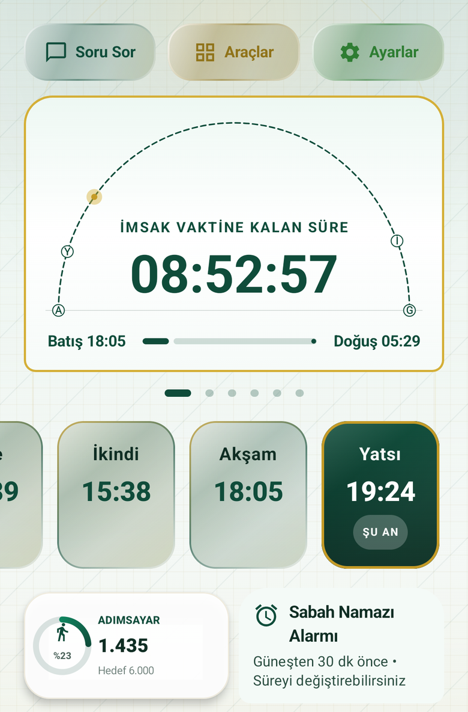
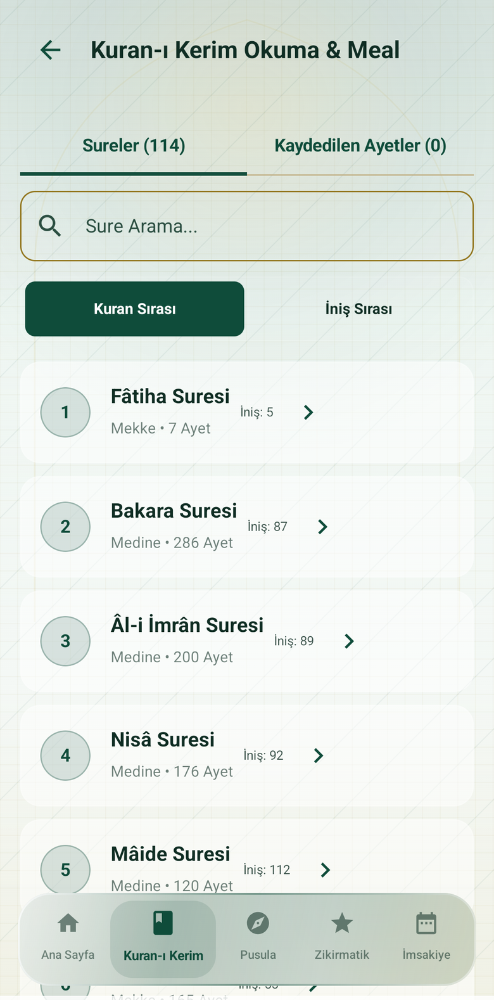
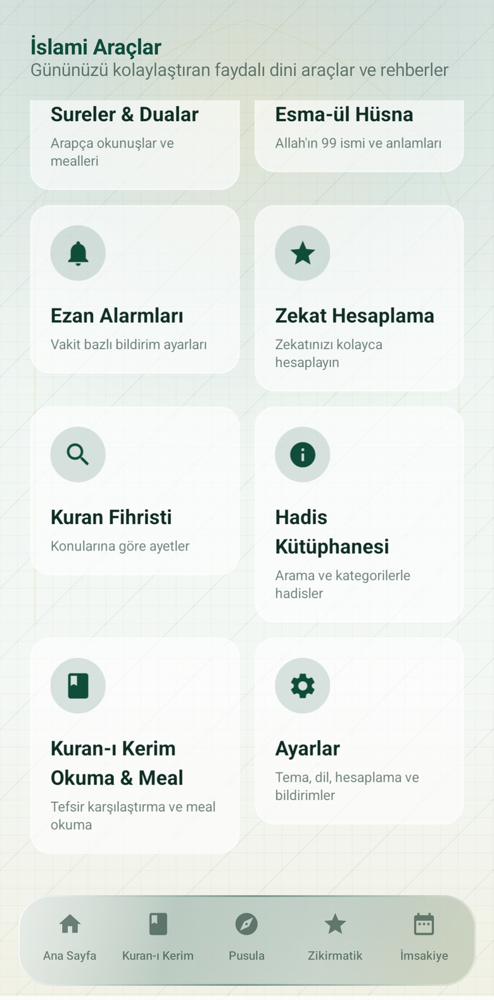

# VakitBox Pro

VakitBox Pro; namaz vakitleri, günlük ibadet araçları ve Kur’an kaynaklarını tek bir Android uygulamasında birleştirir. Uygulama Kotlin ve Jetpack Compose ile geliştirilmiştir; mevcut uygulama ikonu korunmuştur.

## Ekran görüntüleri

<p align="center">
  
  
  
</p>

## Özellikler

### Namaz vakitleri ve bildirimler

- Seçilen konuma göre günlük namaz vakitleri ve bir sonraki vakte kalan süre.
- Vakit girmeden 10 dakika önce ve vakit başladığında bildirim.
- Bildirim alanında sürekli görünen geri sayım; vakit bildirimi geri sayımın altında kalır ve beş dakika sonra otomatik kapanır.
- Durum çubuğunda büyük, okunaklı ve canlı kalan-süre göstergesi.
- Konum seçimi ve farklı vakit hesaplama yöntemleri.

### Sabah Namazı alarmı

- Alarm saatini güneş doğuşuna göre her gün yeniler.
- Varsayılan alarm güneş doğuşundan 30 dakika öncedir; bu süre değiştirilebilir ve birden fazla alarm kurulabilir.
- Alarm sesi ve erteleme/kapatma kontrolleri Android alarm davranışını izler.

### Çevrimdışı Kur’an fihristi

- Sorguyu yalnızca kelime eşleşmesiyle aramaz; aranan konunun anlamına yakın ayetleri cihazda sıralar.
- Arama internet bağlantısı, API veya API anahtarı istemez. Model ve arama verileri uygulamayla birlikte gelir.
- 114 sure ve 6.236 ayet üzerinde çalışır; sonuçlar sure ve ayet bilgisiyle gösterilir.

### Kur’an okuma ve diğer araçlar

- Sure ve ayet listesi, meal/çeviri seçenekleri, sesli tilavet ve kaydedilmiş ayetler.
- Kıble pusulası, imsakiye ve hicrî takvim.
- Zikir sayacı, günlük adım sayar, namaz öğrenme rehberi ve kaza namazı takibi.
- Yakındaki camileri bulma, dua ve sure içerikleri, Esma-ül Hüsna ve zekât hesaplama.
- Tema seçenekleri, ana ekran araç takımı ve farklı ekran boyutlarına uyumlu arayüz.

Kur’an fihristi tamamen cihazda çalışır. Hava durumu, harita ve isteğe bağlı asistan gibi bazı çevrimiçi özellikler internet bağlantısı gerektirebilir.

## Kurulum

Yayımlanan kurulum paketleri için [GitHub Releases](https://github.com/mcelikart/vakitbox-pro/releases) sayfasına bakın. Kaynak kodunu Android Studio ile açabilir veya JDK 17 ve Android SDK kurulu bir ortamda derleyebilirsiniz.

Arama modeli Git LFS ile saklanır. Depoyu klonladıktan sonra model dosyasını indirin:

```sh
git lfs install
git lfs pull
```

Debug APK üretmek için:

```sh
./gradlew assembleDebug
```

Minify ve kaynak küçültmesi etkin, telefonda denemeye uygun APK için:

```sh
./gradlew assemblePreview
```

`assemblePreview` çıktısı `app/build/outputs/apk/preview/app-preview.apk` konumunda oluşur.

## Geliştirme bilgileri

- Android için Kotlin, Jetpack Compose ve Material 3.
- Kur’an konu araması için cihazda çalışan ONNX Runtime modeli.
- Minimum Android sürümü: Android 7.0 (API 24).
- Sürüm numarası ve Android yapı kodunun tek kaynağı `version.properties` dosyasıdır. Kaynak değişikliklerini paketlerken yama sürümü ve yapı kodu otomatik ilerler; ayrıntılar için [VERSIONING.md](VERSIONING.md) dosyasına bakın.
- Testler: `./gradlew testDebugUnitTest`.

## Kaynaklar ve lisanslar

Kur’an metni, arama modeli ve kaynak notları `app/src/main/assets/quran_search` altında bulunur. Bu dizindeki lisans ve bildirim dosyalarını dağıtım sırasında koruyun.

## İletişim

Sorular ve geri bildirim için: [mcelik.art@gmail.com](mailto:mcelik.art@gmail.com)
