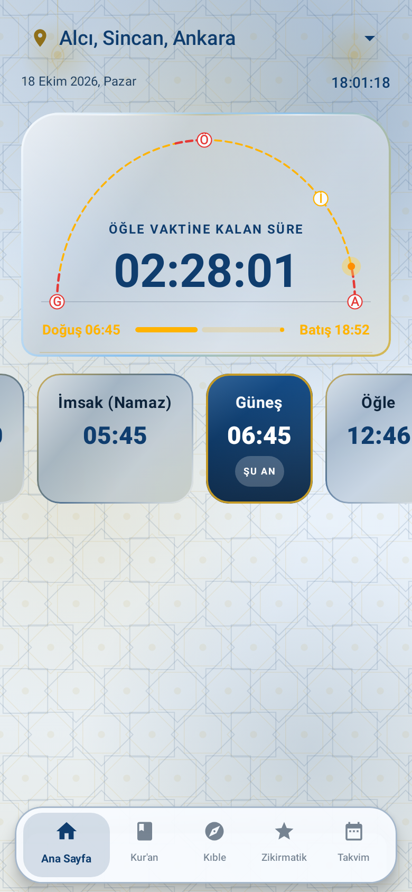
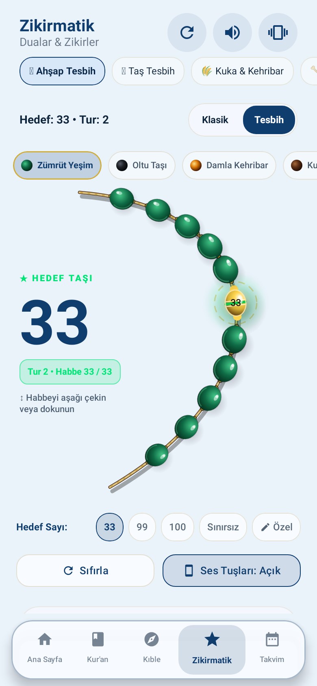
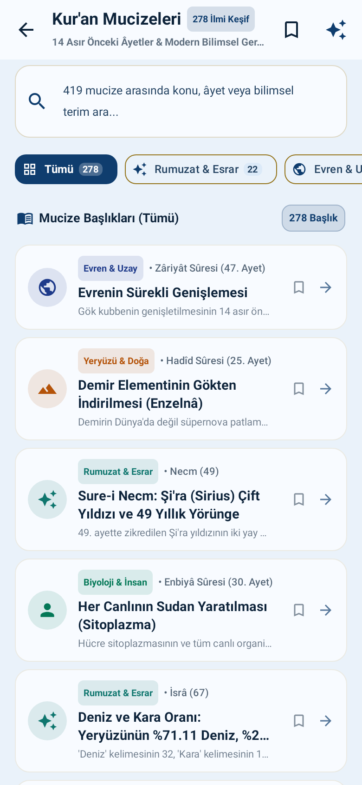
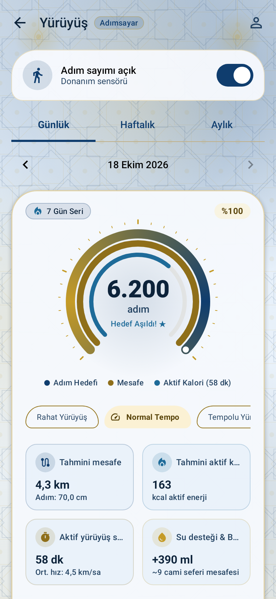
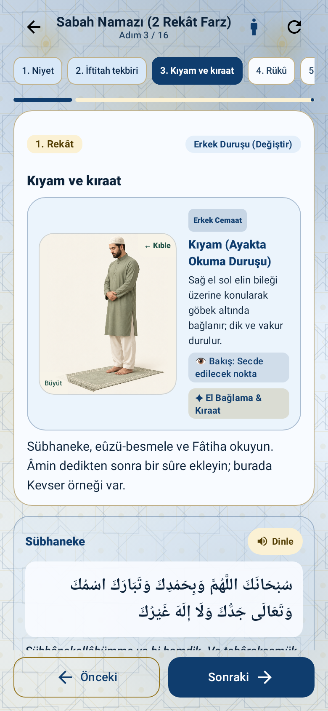
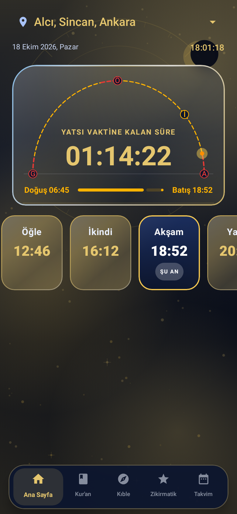
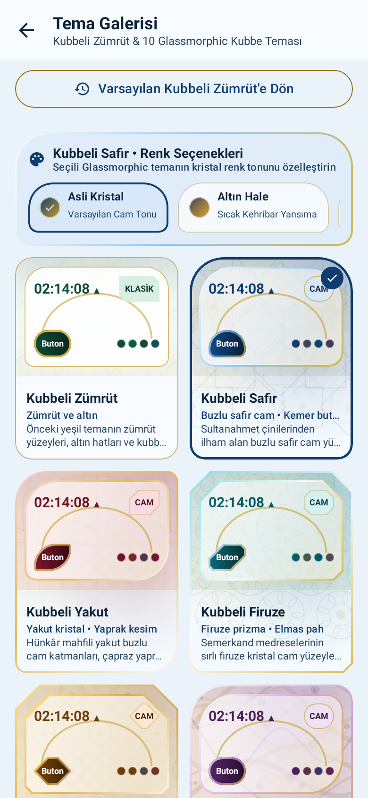
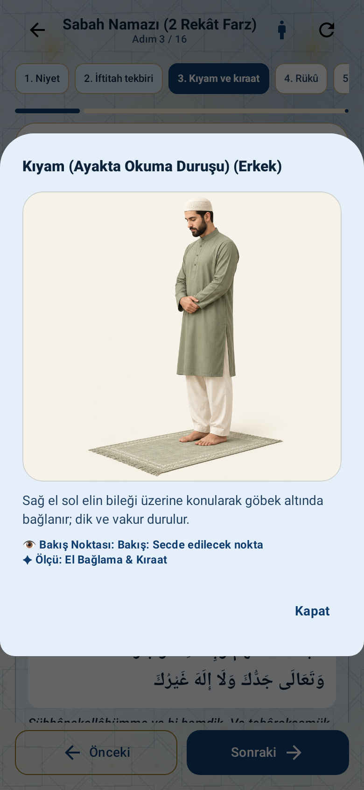

# 🕌 Ezan Vakti - Modern İslami Yaşam & İbadet Rehberi (Android)

<div align="center">
  
  <br/><br/>

  [](https://www.android.com/)
  [](https://kotlinlang.org/)
  [](https://developer.android.com/jetpack/compose)
  [](https://ai.google.dev/)
  []()
  []()
  [-2ea44f?style=for-the-badge&logo=android&logoColor=white)](https://github.com/mcelikart/ezan-vakti/releases/download/v1.1.0/ezan-vakti-guncellenmis.apk)

  <p align="center">
    <b>Modern Jetpack Compose mimarisi ile geliştirilmiş, zengin özellikli, yapay zeka destekli hepsi-bir-arada İslami mobil yaşam asistanı.</b>
  </p>
</div>

---

## 📥 Uygulamayı İndir (APK)

Güncellenmiş son sürümü Android cihazınıza doğrudan indirip kurabilirsiniz:

<p align="left">
  <a href="https://github.com/mcelikart/ezan-vakti/releases/download/v1.1.0/ezan-vakti-guncellenmis.apk">
    
  </a>
</p>

> 💡 **Not:** APK dosyasını indirdikten sonra cihazınızda açarak yüklemeyi onaylayınız. Tüm sürümler ve sürüm notları için [GitHub Releases](https://github.com/mcelikart/ezan-vakti/releases) sayfasını ziyaret edebilirsiniz.

---

## 🚀 Son Güncellemeler (18 Ekim 2026)

- ⏱️ **Ana Ekran Geri Sayım Kartı Sadeleştirmesi & Tipografi:**
  - Geri sayım kartındaki gereksiz dekoratif kubbe, ilave yaylar ve yuvarlak motifler kaldırılarak göz yormayan, sade ve modern bir tasarıma geçildi; ana güneş yayı ve vakit göstergesi korundu.
  - Sayaç yazı boyutu **36 sp'den 44 sp'ye** büyütüldü. Dar ekran boyutlarında (320dp) veya sistemin büyük yazı tipi modlarında metnin taşmasını önleyen esnek sığdırma mantığı entegre edildi.
- 🧘‍♂️ **Namaz Öğrenme Bölümü & Yüksek Çözünürlüklü Duruş Rehberi:**
  - Eski sade çizimler yerine, detaylı ve yüksek çözünürlüklü **7 yeni ibadet duruşu görseli** (`drawable-nodpi/prayer_pose_*.png`) entegre edildi.
  - Her aşama için hem **Erkek** hem de **Kadın** duruşları ayrı ayrı hazırlandı (toplam 14 duruş varyasyonu). Kullanıcı tek tıkla cinsiyet duruşunu değiştirebilir.
  - İbadet duruşlarına dokunulduğunda açılan **tam ekran görsel büyütme (Zoom / Modal Dialog)** özelliği eklendi.
  - Tüm görseller doğrudan APK içerisine gömüldü; internet bağlantısı olmadan tamamen **çevrimdışı (offline)** çalışır.
- 📝 **İbadet ve Kişisel Notlar:** Uygulamaya yeni `NotesSection` bileşeni dahil edildi.
- 🧪 **Kapsamlı Ekran Doğrulama ve Roborazzi Testleri:** 11 temanın farklı çözünürlüklerde (320dp - 420dp) ve 1.5× metin ölçeklerinde taşma testleri başarıyla tamamlandı.

---

## 📌 Genel Bakış

**Ezan Vakti**, modern Android tasarım ilkeleri (Material 3) ve saf Jetpack Compose kullanılarak inşa edilmiş kapsamlı bir mobil uygulamadır. Geleneksel ezan vakti uygulamalarının ötesine geçerek; yapay zeka destekli Kur'an araştırması, bilimsel Kur'an mucizeleri ansiklopedisi, sesli tilavet, hassas sensör destekli kıble pusulası, adım sayar ve akıllı widget desteğini tek bir çatı altında birleştirir.

---

## 📱 Uygulama Ekran Görüntüleri

<div align="center">
  <table>
    <tr>
      <td align="center"><b>🕌 Ezan Vakitleri (44 sp Yeni Sayaç)</b></td>
      <td align="center"><b>🧭 Kıble Pusulası (Hassas Sensör)</b></td>
      <td align="center"><b>📿 Akıllı Zikirmatik & Tesbih</b></td>
    </tr>
    <tr>
      <td align="center"></td>
      <td align="center"></td>
      <td align="center"></td>
    </tr>
    <tr>
      <td align="center"><b>🔬 Kur'an Mucizeleri (100+ Keşif)</b></td>
      <td align="center"><b>🚶‍♂️ Adımsayar & Sağlık Takibi</b></td>
      <td align="center"><b>🤲 Namaz Öğreniyorum (Detaylı Duruşlar)</b></td>
    </tr>
    <tr>
      <td align="center"></td>
      <td align="center"></td>
      <td align="center"></td>
    </tr>
    <tr>
      <td align="center"><b>🌙 Gece Çinisi (Koyu Tema)</b></td>
      <td align="center"><b>🎨 11 Zengin Miras Teması</b></td>
      <td align="center"><b>🔍 Duruş Büyütme (Tam Ekran İnceleme)</b></td>
    </tr>
    <tr>
      <td align="center"></td>
      <td align="center"></td>
      <td align="center"></td>
    </tr>
  </table>
</div>

---

## ✨ Öne Çıkan Özellikler

### 1. 🕌 Hassas Ezan ve Namaz Vakitleri
- **Konum Tabanlı Otomatik Hesaplama:** GPS veya manuel şehir seçimi ile Diyanet ve Aladhan uyumlu milimetrik vakit hesaplama.
- **Sonraki Vakte Geri Sayım:** Canlı kronometre ile sonraki namaz vaktine kalan süreyi saniye saniye takip edebilme (44 sp büyük, okunaklı font).
- **Gelişmiş Bildirimler:** Vakit girdiğinde veya vakit öncesinde sesli/titreşimli ezan bildirimleri.
- **Genişletilebilir Bildirim Kartı:** Kilit ekranından veya bildirim panelinden günün tüm vakitlerini tek bakışta görebilme.

### 2. 🧭 Sensör Destekli Kıble Pusulası (Qibla Compass)
- Cihazın manyetik alan ve ivmeölçer sensör füzyonunu kullanarak **Kabe-i Muazzama** istikametini en yüksek doğrulukla tespit eder.
- Titreşimli geri bildirim ile doğru kıble açısına ulaşıldığında kullanıcıyı bilgilendirir.

### 3. 📖 Kur'an-ı Kerim ve Sesli Tilavet
- **114 Surenin Tamamı:** Orijinal Arapça hat, Latin harfleriyle okunuş ve Türkçe meal.
- **Yüksek Kaliteli Ses Akışı:** Dünyaca ünlü karilerden ayet ayet veya sure bazında dinleme (AlQuran Audio Stream).
- **Hızlı Önbellekleme & Arama:** Sure adına, ayet numarasına veya meal içeriğine göre anında arama.

### 4. 🔬 Kur'an Mucizeleri Kütüphanesi (100+ Bilimsel Araştırma)
Modern bilimin 20. ve 21. yüzyılda keşfettiği evren kanunlarının Kur'an'daki işaretlerini içeren 16 derin kategori:
- 🌌 **Astrofizik & Kuantum:** Evrenin genişlemesi, karadelikler, gök cisimlerinin yörüngeleri.
- 🌊 **Oşinografi & Hidroloji:** Birbirine karışmayan denizler, derin okyanus karanlıkları ve iç dalgalar.
- 🧬 **Tıp, Embriyoloji & Genetik:** İnsanın anne karnındaki evreleri, parmak izi sırrı, nöroloji.
- 🌿 **Biyomimetik, Botanik & Jeoloji:** Dağların kazık işlevi, bitkilerdeki çift yaratılış.
- 🏛️ **Tarih & Kayıp Medeniyetler:** İrem şehri, Firavun'un cesedi, Haman ismi ve arkeolojik bulgular.

### 5. 🤖 Yapay Zeka Destekli Kur'an Arama Motoru (Google Gemini)
- Doğal dil işleme (NLP) yetenekleriyle, aklınıza takılan dini ve felsefi soruları mealler ve tefsirler ışığında semantik olarak aratabilme.
- Konu bazlı ayet eşleştirme ve anlam bütünlüğü analizi.

### 6. 📿 Akıllı Zikirmatik & Tesbihat
- **Dokunsal Geri Bildirim (Haptic Feedback):** Ekrana bakmadan zikir çekebilmek için özel titreşim tepkileri.
- **Hedef Belirleme:** 33, 99 veya serbest sayaç modları.
- **Sesli Uyarı & Sayaç Kaydı:** Zikirleriniz otomatik olarak hafızaya kaydedilir.

### 7. 🤲 Adım Adım Namaz Öğrenme Rehberi
- Sabah, Öğle, İkindi, Akşam, Yatsı, Vitir ve Cuma namazlarının görsel anlatımı.
- Yüksek kaliteli görsel duruş rehberi (Kadın ve erkek için ayrı çizimler, tam ekran büyütme).
- Abdest alma, boy abdesti (gusül), teyemmüm rehberi.
- Rekat rekat kılınış tabloları, sesli meal ve dua desteği.

### 8. 📅 Hicri Takvim & Dini Günler
- Kandiller (Mevlid, Regaip, Miraç, Berat), Kadir Gecesi, Ramazan ve Kurban Bayramı tarihleri.
- Hicri ve Miladi takvim senkronizasyonu.

### 9. 🚶‍♂️ Adımsayar ve Yürüyüş Metrikleri
- Düşük güç tüketimli **Foreground Step Sensor Service**.
- Günlük atılan adım, kat edilen mesafe (km), harcanan kalori (MET bilimi ve boy/kilo bazlı hesaplama).
- Camiye yürüyüş ve günlük hareket istatistikleri.

### 10. 🎨 Gelişmiş Tema Motoru (Heritage Theme Engine)
- Modern ve İslami geometrik desenlerle süslenmiş çoklu tema desteği.
- Açık (Light) ve Koyu (Dark) mod ile tam uyumlu dinamik kontrast yapısı.
- Göz yormayan, gece ibadetlerine uygun karanlık arayüz optimizasyonu.

### 11. 📱 Android Ana Ekran Widget'ı (AppWidget)
- Uygulamayı açmaya gerek kalmadan, ana ekranınızda bir sonraki vakti ve kalan süreyi gösteren şık widget.

---

## 🛠️ Kullanılan Teknolojiler ve Mimari

| Kategori | Teknoloji / Kütüphane |
|---|---|
| **Dil** | Kotlin 100% |
| **Kullanıcı Arayüzü** | Jetpack Compose, Material 3, Compose Navigation |
| **Mimari** | MVVM (Model-View-ViewModel), Clean Architecture prensipleri |
| **Asenkron / Reaktif** | Coroutines, Kotlin StateFlow & SharedFlow |
| **Ağ / API** | Retrofit 2, OkHttp 3, Gson / Moshi |
| **Yapay Zeka** | Google Gemini API (Generative AI SDK) |
| **Sensör Yönetimi** | Android SensorManager (Compass / Step Counter) |
| **Arka Plan İşleri** | Android Foreground Service, BroadcastReceiver |
| **Widget Desteği** | Android AppWidgetProvider & RemoteViews |
| **Görsel Doğrulama** | Roborazzi & Robolectric Native Graphics Screenshot Testing |
| **Yapı Sistemi** | Gradle Kotlin DSL (`build.gradle.kts`) |

---

## 📂 Proje Dizin Yapısı

```text
ezan-vakti/
├── app/
│   ├── src/
│   │   ├── main/
│   │   │   ├── java/com/example/
│   │   │   │   ├── data/              # API servisleri, modeller, veri kaynakları ve mucize veritabanı
│   │   │   │   ├── steps/             # Adımsayar servisi, hesaplama algoritmaları ve raporlama
│   │   │   │   ├── ui/                # Jetpack Compose ekranları, ViewModel ve UI bileşenleri
│   │   │   │   │   ├── HomeScreen.kt
│   │   │   │   │   ├── CompassScreen.kt
│   │   │   │   │   ├── DhikrScreen.kt
│   │   │   │   │   ├── PrayerLearningScreen.kt
│   │   │   │   │   ├── NotesSection.kt
│   │   │   │   │   ├── PrayerViewModel.kt
│   │   │   │   │   ├── PrayerWidgetProvider.kt
│   │   │   │   │   └── theme/         # Renk paletleri, miras temaları ve desenler
│   │   │   │   └── MainActivity.kt
│   │   │   └── res/                   # İkonlar, yüksek çözünürlüklü duruş görselleri (drawable-nodpi), layout'lar
│   │   └── test/                      # Roborazzi görsel regresyon ve birim testleri
│   └── build.gradle.kts
├── screenshots/                       # Dokümantasyon önizleme ekran görüntüleri
├── gradle/
├── build.gradle.kts
├── settings.gradle.kts
└── README.md
```

---

## 🚀 Kurulum ve Çalıştırma

### Gereksinimler
- **Android Studio:** Ladybug (2024.2+) veya üzeri
- **JDK:** Java 17 veya üzeri
- **Android SDK:** Min SDK 26 (Android 8.0), Target SDK 34/35

### Adımlar

1. **Projeyi Klonlayın veya İndirin:**
   ```bash
   git clone https://github.com/mcelikart/ezan-vakti.git
   cd ezan-vakti
   ```

2. **Android Studio ile Açın:**
   - Android Studio'yu başlatın ve **Open** seçeneğiyle proje klasörünü seçin.
   - Gradle bağımlılıklarının senkronize olmasını bekleyin.

3. **API Anahtarları (İsteğe Bağlı):**
   - Yapay zeka destekli arama motorunu kullanmak için [Google AI Studio](https://aistudio.google.com/)'dan temin edeceğiniz Gemini API anahtarınızı proje ana dizininde oluşturacağınız `.env` dosyasına ekleyin:
     ```env
     GEMINI_API_KEY=your_gemini_api_key_here
     ```

4. **Derleyin ve Çalıştırın:**
   - Emülatör veya USB hata ayıklama modu açık fiziksel bir Android cihaz bağlayın.
   - Android Studio'da **Run ('app')** butonuna tıklayın veya terminalden:
     ```bash
     ./gradlew assembleDebug
     ```

---

## 🤝 Katkıda Bulunma

Projeye katkıda bulunmak isterseniz:
1. Bu depoyu çatallayın (Fork edin).
2. Yeni bir özellik dalı oluşturun (`git checkout -b feature/YeniOzellik`).
3. Değişikliklerinizi commit edin (`git commit -m 'feat: Yeni özellik eklendi'`).
4. Dalınıza push yapın (`git push origin feature/YeniOzellik`).
5. Bir **Pull Request** açın.

---

## 📄 Lisans

Bu proje açık kaynaklı olup **MIT Lisansı** ile lisanslanmıştır. Detaylar için `LICENSE` dosyasına göz atabilirsiniz.

---

## 📬 İletişim

Görüş, öneri, hata bildirimi veya iş birliği için:
📧 **E-posta:** [mcelik.art@gmail.com](mailto:mcelik.art@gmail.com)
